# 🌐 Nexora — Expand your Orbit

**A location-aware social discovery platform built with React, Node.js, Express.js, and MongoDB.**

Nexora helps users discover nearby people through geographical proximity, shared interests, and common goals. It combines geospatial search, privacy-conscious location handling, secure authentication, connection management, and messaging in a full-stack application built around an MVC + Service Layer architecture.

---

## 📋 Table of Contents

- [Overview](#-overview)
- [Key Features](#-key-features)
- [Tech Stack](#-tech-stack)
- [Architecture Diagram](#-architecture-diagram)
- [Database EER Diagram](#-database-eer-diagram)
- [API Request Flow](#-api-request-flow)
- [Connection and Messaging Sequence](#-connection-and-messaging-sequence)
- [Project Structure](#-project-structure)
- [Installation](#-installation)
- [API Documentation](#-api-documentation)
- [Real-Time Messaging](#-real-time-messaging)
- [Security and Privacy](#-security-and-privacy)
- [API Testing](#-api-testing)
- [Screenshots](#-screenshots)
- [Development Progress](#-development-progress)
- [Author](#-author)

---

## 🌟 Overview

Discovering nearby people with similar interests, learning objectives, or professional ambitions is not always straightforward. Nexora brings local discovery and purposeful connections into one platform.

Users can explore profiles based on proximity and shared interests, send connection requests, manage accepted connections, and communicate through messaging. An administrative interface provides tools for managing users, reviewing reports, and configuring application settings.

### Engineering Objectives

- **Geospatial discovery:** Use GeoJSON and MongoDB geospatial indexing to support efficient proximity queries.
- **Location privacy:** Separate discovery-location handling from sensitive location information.
- **Secure authentication:** Use short-lived access tokens, refresh-token rotation, HTTP-only cookies, and password hashing.
- **Strict validation:** Validate client-controlled payloads before they reach application controllers.
- **Layered architecture:** Isolate transport handling, business rules, and database persistence.
- **Controlled communication:** Enforce connection and conversation authorization on the server.

---

## ✨ Key Features

### 📍 Geospatial Discovery

- Discover eligible users based on proximity.
- GeoJSON `Point` coordinates with longitude-first coordinate ordering.
- MongoDB `2dsphere` spatial indexes.
- Spherical distance queries using `$nearSphere`.
- Configurable discovery radius from 2 km to 1000 km, with predefined distance options.
- Profile discovery based on interests, goals, and discovery preferences.
- Explicit selection of profile fields to avoid returning sensitive location data.

### 🔐 Authentication and Security

- User registration, login, refresh-token, and logout workflows.
- JWT-based access and refresh tokens.
- 15-minute access-token lifetime and 7-day refresh-token lifetime.
- HTTP-only cookies with `SameSite=Strict`.
- Password hashing using bcrypt.
- Refresh-token rotation and session invalidation.
- Protected routes and account-status enforcement.
- Zod-based runtime payload validation.
- Centralized backend error handling.

### 🤝 Connection Management

- Send and receive connection requests.
- Manage pending and accepted connections.
- Prevent unauthorized access to private interactions.
- Enforce connection eligibility before messaging.
- Handle reverse connection requests according to connection rules.

### 💬 Messaging

- Conversation-based communication.
- Bidirectional messaging through Socket.IO.
- Message history with cursor-based pagination.
- Conversation participant authorization.
- Server-side validation of message operations.
- Conversation metadata and latest-message tracking.

### 🛡️ Administrative Dashboard

- Dashboard overview.
- User management.
- Report review.
- Application settings.
- Registration availability controls.
- Maintenance-mode controls.

### 🧩 Backend Engineering

- MVC + Service Layer architecture.
- Reusable authentication and authorization middleware.
- Zod validation at the request boundary.
- Mongoose models for persistent data.
- Structured logging using Winston.
- Media and file handling using the application's configured upload integrations.

---

## 🛠 Tech Stack

| Category          | Technologies                                | Responsibility                              |
| ----------------- | ------------------------------------------- | ------------------------------------------- |
| Frontend          | React, JavaScript, HTML, CSS, Tailwind CSS | User interface and application interactions |
| Backend           | Node.js, Express.js                         | REST APIs and server-side execution         |
| Database          | MongoDB, Mongoose                           | Document persistence and data modelling     |
| Geospatial        | GeoJSON, `2dsphere`, `$nearSphere`          | Indexed proximity discovery                 |
| Authentication    | JWT, HTTP-only cookies                      | Authentication and session lifecycle        |
| Password security | bcrypt                                      | Password hashing                            |
| Validation        | Zod                                         | Runtime request validation                  |
| Real-time         | Socket.IO                                   | Bidirectional message communication         |
| Logging           | Winston                                     | Application logs and diagnostics            |
| File handling     | Multer, Cloudinary                          | Upload processing and media storage         |
| Development       | Git, GitHub, Postman                        | Version control and API testing             |

---

## 🏗 Architecture Diagram

Nexora follows an MVC architecture with a dedicated service layer. This separation keeps HTTP transport, application rules, and database operations independently organized.

The following diagram illustrates Nexora's client, backend, real-time communication, and data layers.

<p align="center">
  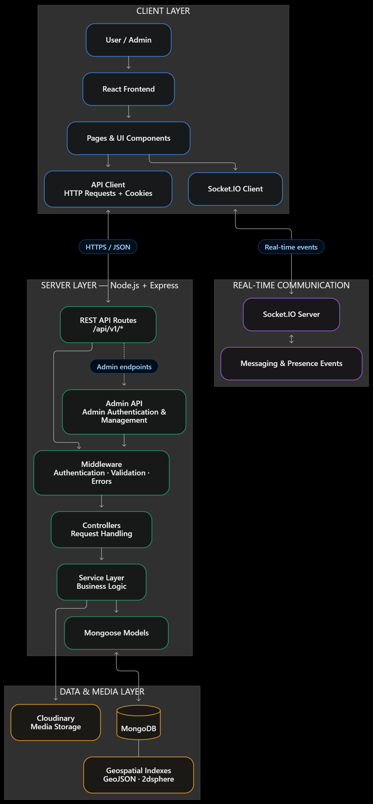
</p>

### Layer Responsibilities

| Layer       | Responsibility                                                                       |
| ----------- | ------------------------------------------------------------------------------------ |
| Routes      | Define HTTP endpoints and middleware chains                                          |
| Middleware  | Authenticate requests, validate payloads, and enforce access rules                   |
| Controllers | Translate requests into service calls and format responses                           |
| Services    | Implement authentication, discovery, connection, messaging, and administrative logic |
| Models      | Define persistent document schemas and database interactions                         |
| Socket.IO   | Handle authenticated socket connections and messaging events                         |
| MongoDB     | Persist users, connections, conversations, messages, and settings                    |

**Architectural principle:** Controllers coordinate requests; services enforce business rules; models handle persistence. Socket events must enforce the same relevant access-control rules as REST endpoints.

---

## 📊 Database EER Diagram

The following diagram illustrates the logical relationships between Nexora's core application entities and their references in MongoDB.

<p align="center">
  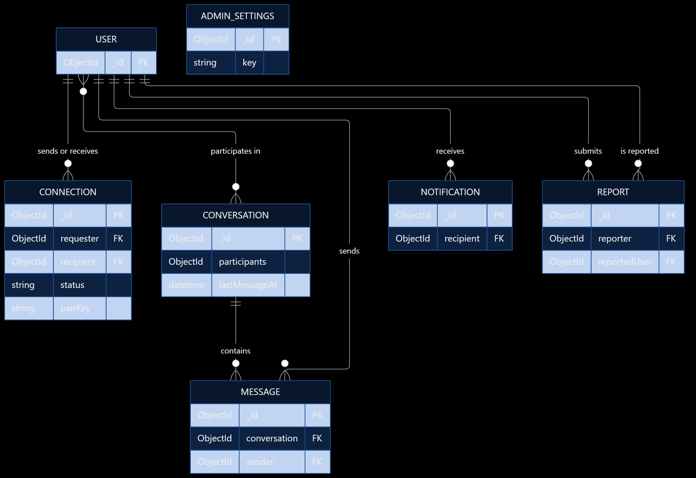
</p>

### Data Model Responsibilities

- **Users:** Identity, profile data, account state, interests, and location-related fields.
- **Connections:** Requester, recipient, connection pair, and relationship status.
- **Conversations:** Conversation identity and metadata for messaging.
- **Messages:** Sender, conversation association, and message content.
- **Admin settings:** Application-wide administrative configuration.

MongoDB schemas may contain additional fields and metadata. The diagram shows the logical domain entities rather than every stored property.

### Geospatial Indexing

Discovery coordinates are represented as GeoJSON points:

```json
{
  "type": "Point",
  "coordinates": [77.5946, 12.9716]
}
```

Longitude is stored before latitude.

### Location Privacy

Nexora distinguishes discovery-location handling from sensitive user-location information. Public profile responses should contain only the data required by the discovery interface.

A separate discovery field is not, on its own, a guarantee of anonymity. Production deployments should also restrict query frequency, validate discovery inputs, and consider coordinate precision and location-inference risks.

---

## 🔄 API Request Flow

This diagram illustrates how requests move through Nexora's frontend, Express middleware, controllers, service layer, and MongoDB, including authentication, validation, and centralized error handling.

<p align="center">
  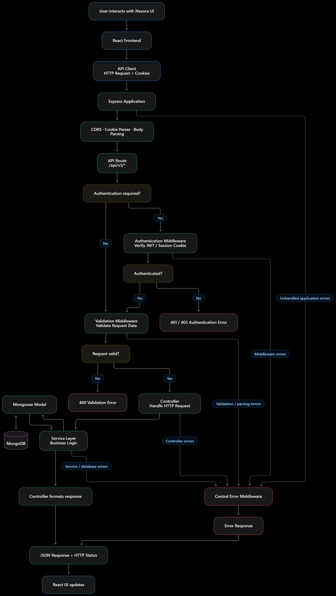
</p>

### Why This Design?

- Authentication and validation are handled before business logic executes.
- Controllers remain focused on request and response handling.
- Services encapsulate application rules.
- Database operations are separated from transport code.
- Errors are routed through a central handling mechanism.

---

## 📈 Connection and Messaging Sequence

This sequence illustrates Nexora's connection-request lifecycle, request acceptance, conversation creation, and message exchange through the REST API, with an optional real-time delivery path.

<p align="center">
  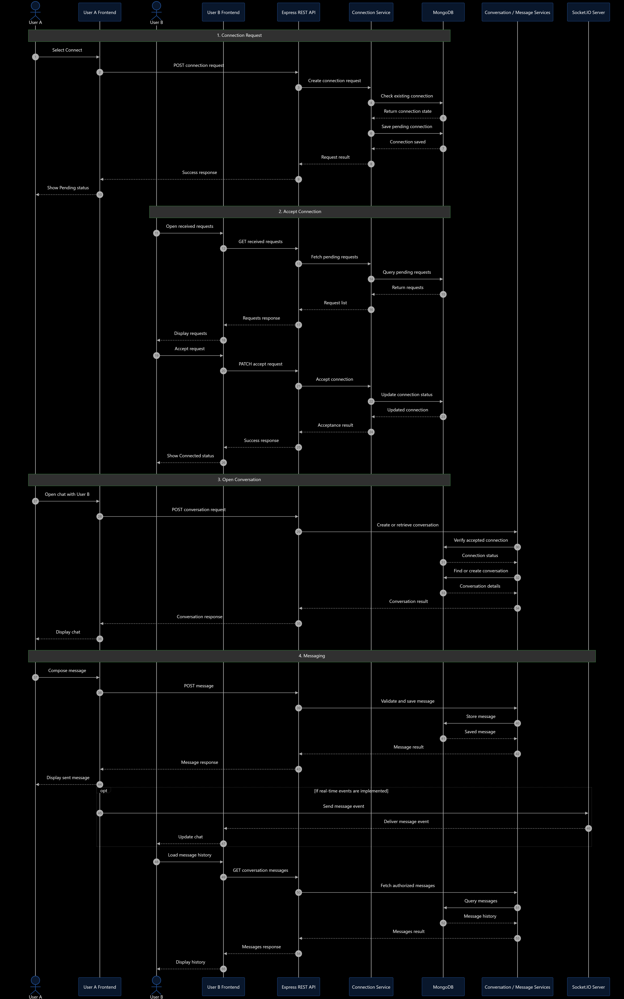
</p>

---

## 📁 Project Structure

```text
nexora/
├── backend/
│   ├── docs/
│   │   ├── admin-management/
│   │   ├── authentication/
│   │   ├── connection-management/
│   │   ├── database/
│   │   ├── message-management/
│   │   ├── notification-management/
│   │   ├── settings-management/
│   │   └── user-management/
│   ├── logs/                         # Application logs
│   ├── scripts/
│   │   └── createAdmin.js            # Admin creation script
│   ├── src/
│   │   ├── config/
│   │   │   └── database.js           # Database configuration
│   │   ├── controllers/
│   │   │   ├── admin/
│   │   │   │   ├── adminAuth.controller.js
│   │   │   |   ├── adminReport.controller.js
│   │   │   |   ├── adminSettings.controller.js
│   │   │   |   └── adminUser.controller.js
│   │   │   ├── account.controller.js
│   │   │   ├── auth.controller.js
│   │   │   ├── connection.controller.js
│   │   │   ├── conversation.controller.js
│   │   │   ├── message.controller.js
│   │   │   ├── moderationNotification.controller.js
│   │   │   ├── notification.controller.js
│   │   │   ├── report.controller.js
│   │   │   ├── security.controller.js
│   │   │   ├── settings.controller.js
│   │   │   └── user.controller.js
│   │   ├── middleware/
│   │   │   ├── adminAuth.middleware.js
│   │   │   ├── auth.middleware.js
│   │   │   ├── chatUpload.middleware.js
│   │   │   ├── error.middleware.js
│   │   │   ├── maintenance.middleware.js
│   │   │   ├── upload.middleware.js
│   │   │   └── validation.middleware.js
│   │   ├── models/
│   │   │   ├── admin.model.js
│   │   │   ├── adminSettings.model.js
│   │   │   ├── connection.model.js
│   │   │   ├── conversation.model.js
│   │   │   ├── message.model.js
│   │   │   ├── notification.model.js
│   │   │   ├── report.model.js
│   │   │   └── user.model.js
│   │   ├── routes/
│   │   │   ├── admin/
│   │   │   │   ├── adminAuth.routes.js
│   │   │   │   ├── adminReport.routes.js
│   │   │   │   ├── adminSettings.routes.js
│   │   │   │   └── adminUser.routes.js
│   │   │   ├── auth.routes.js
│   │   │   ├── connection.routes.js
│   │   │   ├── conversation.routes.js
│   │   │   ├── message.routes.js
│   │   │   ├── notification.routes.js
│   │   │   ├── security.routes.js
│   │   │   ├── settings.routes.js
│   │   │   └── user.routes.js
│   │   ├── services/
│   │   │   ├── admin/
│   │   │   │   ├── adminAuth.service.js
│   │   │   │   ├── adminReport.service.js
│   │   │   │   ├── adminSettings.service.js
│   │   │   │   └── adminUser.service.js
│   │   │   ├── auth.service.js
│   │   │   ├── cloudinary.service.js
│   │   │   ├── connection.service.js
│   │   │   ├── conversation.service.js
│   │   │   ├── location.service.js
│   │   │   ├── message.service.js
│   │   │   ├── messageReceipt.service.js
│   │   │   ├── moderationNotification.service.js
│   │   │   ├── notification.service.js
│   │   │   ├── report.service.js
│   │   │   ├── security.service.js
│   │   │   ├── settings.service.js
│   │   │   └── user.service.js
│   │   ├── socket/
│   │   │   ├── presence.js            # Presence-related socket logic
│   │   │   ├── socket.js              # Socket.IO configuration
│   │   │   └── socket.middleware.js   # Socket middleware
│   │   ├── utils/
│   │   │   ├── apiErrors.js
│   │   │   ├── apiResponse.js
│   │   │   ├── asyncHandler.js
│   │   │   ├── cloudinary.js
│   │   │   ├── cookieOptions.js
│   │   │   ├── locationUtils.js
│   │   │   └── logger.js
│   │   ├── validations/
│   │   │   ├── account.validation.js
│   │   │   ├── adminSettings.validation.js
│   │   │   ├── auth.validation.js
│   │   │   ├── common.validation.js
│   │   │   ├── connection.validation.js
│   │   │   ├── conversation.validation.js
│   │   │   ├── message.validation.js
│   │   │   ├── security.validation.js
│   │   │   ├── settings.validation.js
│   │   │   └── user.validation.js
│   │   ├── app.js                     # Express application setup
│   │   └── server.js                  # Backend entry point
│   ├── .env                           # Local environment variables
│   ├── .env.example                   # Environment variable template
│   ├── .gitignore
│   ├── package.json
│   ├── package-lock.json
│   └── README.md
│
├── docs/
│   └── images/
│       ├── nexora-api-request-flow.png
│       ├── nexora-architecture.png
│       ├── nexora-connection-messaging.png
│       └── nexora-database-eer.png
│
├── frontend/
│   ├── public/                         # Public static assets
│   ├── src/
│   │   ├── components/
│   │   │   ├── admin/
│   │   │   │   ├── AdminLayout.jsx
│   │   │   │   └── ProtectedAdminRoute.jsx
│   │   │   ├── auth/
│   │   │   │   └── ProtectedRoute.jsx
│   │   │   ├── landing/
│   │   │   │   └── Hero3D.jsx
│   │   │   ├── layout/
│   │   │   │   ├── AppLayout.jsx
│   │   │   │   ├── Sidebar.jsx
│   │   │   │   ├── Topbar.jsx
│   │   │   │   ├── UserAppLayout.jsx
│   │   │   │   ├── ModerationNoticeManager.jsx
│   │   │   │   └── ModerationNoticeModal.jsx
│   │   │   ├── context/
│   │   │   │   ├── AdminAuthContext.jsx
│   │   │   │   └── AuthContext.jsx
│   │   │   ├── pages/
│   │   │   │   ├── admin/
│   │   │   │   │   ├── AdminDashboard.jsx
│   │   │   │   │   ├── AdminLogin.jsx
│   │   │   │   │   ├── AdminReports.jsx
│   │   │   │   │   ├── AdminSettings.jsx
│   │   │   │   │   └── AdminUsers.jsx
│   │   │   │   ├── auth/
│   │   │   │   │   ├── Login.jsx
│   │   │   │   │   ├── ProfileCompletionGate.jsx
│   │   │   │   │   └── Register.jsx
│   │   │   │   ├── public/
│   │   │   │   │   ├── LandingPage.css
│   │   │   │   │   ├── LandingPage.jsx
│   │   │   │   │   ├── LegalPages.css
│   │   │   │   │   ├── PrivacyPolicy.jsx
│   │   │   │   │   └── TermsOfService.jsx
│   │   │   │   └── user/
│   │   │   │       ├── Chat.jsx
│   │   │   │       ├── Connections.jsx
│   │   │   │       ├── Discover.jsx
│   │   │   │       ├── EditProfileModal.jsx
│   │   │   │       ├── Home.jsx
│   │   │   │       ├── LocationSetup.jsx
│   │   │   │       ├── Messages.jsx
│   │   │   │       ├── MyProfile.jsx
│   │   │   │       ├── Notifications.jsx
│   │   │   │       ├── Profile.jsx
│   │   │   │       ├── ProfileOnboarding.jsx
│   │   │   │       ├── Requests.jsx
│   │   │   │       └── Settings.jsx
│   │   │   ├── services/
│   │   │   │   ├── adminAuth.service.js
│   │   │   │   ├── adminReport.service.js
│   │   │   │   ├── adminSettings.service.js
│   │   │   │   ├── adminUser.service.js
│   │   │   │   ├── auth.service.js
│   │   │   │   ├── connection.service.js
│   │   │   │   ├── conversation.service.js
│   │   │   │   ├── location.service.js
│   │   │   │   ├── message.service.js
│   │   │   │   ├── moderationNotification.service.js
│   │   │   │   ├── notification.service.js
│   │   │   │   ├── security.service.js
│   │   │   │   ├── settings.service.js
│   │   │   │   └── user.service.js
│   │   │   ├── socket/
│   │   │   │   └── socket.js           # Frontend Socket.IO client
│   │   │   ├── utils/
│   │   │   │   ├── location.js
│   │   │   │   ├── locationCompletion.js
│   │   │   │   └── profileCompletion.js
│   │   │   ├── App.jsx                 # Application routing
│   │   │   ├── index.css
│   │   │   └── main.jsx                # Frontend entry point
│   │   ├── .gitignore
│   │   ├── eslint.config.js
│   │   ├── index.html
│   │   ├── package.json
│   │   ├── package-lock.json
│   │   ├── README.md
│   │   └── vite.config.js
│   │
├── screenshots/
│   ├── admin-dashboard.png
│   ├── admin-reports.png
│   ├── admin-settings.png
│   ├── admin-users.png
│   ├── connections.png
│   ├── home.png
│   ├── login.png
│   ├── messages.png
│   ├── profile.png
│   ├── register.png
│   └── user-dashboard.png
│
└── README.md                           # Main project documentation
```

### Backend

Responsible for authentication, data validation, geospatial discovery, connection workflows, messaging, administrative operations, and MongoDB persistence.

### Frontend

Responsible for user registration and login, discovery pages, profiles, connection management, messaging, and the administrative interface.

---

## ⚙️ Installation

### Prerequisites

- Node.js and npm.
- MongoDB running locally or a MongoDB Atlas database.
- Git.
- A modern web browser.

### 1. Clone the Repository

```bash
git clone https://github.com/Komala-L/nexora.git
cd nexora
```

### 2. Install Backend Dependencies

```bash
cd backend
npm install
```

### 3. Configure Backend Environment

Create `backend/.env`:

```dotenv
NODE_ENV=development
PORT=5000
CLIENT_URL=http://localhost:5173

MONGO_URI=mongodb://localhost:27017/nexora

ACCESS_TOKEN_SECRET=your_32_char_access_secret_change_me
REFRESH_TOKEN_SECRET=your_32_char_refresh_secret_change_me

ACCESS_TOKEN_EXPIRY=15m
REFRESH_TOKEN_EXPIRY=7d
```

Use unique, randomly generated secrets for local development. Never use the example secrets in a deployed environment.

The backend must read the same environment variable names shown above. Token expiry and cookie configuration must also match the authentication implementation.

### 4. Start the Backend

```bash
npm run dev
```

The local backend configuration uses port `5000`.

### 5. Install Frontend Dependencies

Open a second terminal at the repository root:

```bash
cd frontend
npm install
```

Create `frontend/.env`:

```dotenv
VITE_API_BASE_URL=http://localhost:5000/api/v1
```

Configure the frontend API service to use this base URL.

### 6. Start the Frontend

```bash
npm run dev
```

Open the local URL printed by the development server, typically:

```text
http://localhost:5173
```

### 7. Verify the Application

1. Confirm MongoDB is running.
2. Verify the backend connects to MongoDB.
3. Open the frontend and register a test account.
4. Authenticate and inspect the profile and discovery pages.
5. Test connection requests using separate test accounts.
6. Verify that only eligible participants can access conversations.
7. Verify administrative operations using an authorized administrator account.

### Environment Variable Reference

| Variable               | Purpose                      |
| ---------------------- | ---------------------------- |
| `NODE_ENV`             | Runtime environment          |
| `PORT`                 | Backend listening port       |
| `CLIENT_URL`           | Frontend origin              |
| `MONGO_URI`            | MongoDB connection string    |
| `ACCESS_TOKEN_SECRET`  | Access-token signing secret  |
| `REFRESH_TOKEN_SECRET` | Refresh-token signing secret |
| `ACCESS_TOKEN_EXPIRY`  | Access-token lifetime        |
| `REFRESH_TOKEN_EXPIRY` | Refresh-token lifetime       |
| `VITE_API_BASE_URL`    | Frontend API base URL        |

Never commit real `.env` files or production credentials.

---

## 🚀 API Documentation

Nexora provides a versioned REST API under the `/api/v1` prefix. Protected endpoints require authentication and enforce the relevant resource-access rules.

### Authentication

Base path: `/api/v1/auth`

| Method | Endpoint | Access | Description |
|---|---|---|---|
| `POST` | `/api/v1/auth/register` | Public; subject to registration settings | Register a user |
| `POST` | `/api/v1/auth/login` | Public | Authenticate a user |
| `POST` | `/api/v1/auth/refresh-token` | Refresh-token flow | Refresh access authentication |
| `POST` | `/api/v1/auth/logout` | Authenticated | Log out the current user |

### Users and Profiles

Base path: `/api/v1/users`

| Method | Endpoint | Access | Description |
|---|---|---|---|
| `GET` | `/api/v1/users/me` | Authenticated | Retrieve the current user |
| `GET` | `/api/v1/users/moderation-notices` | Authenticated | Retrieve moderation notices |
| `PATCH` | `/api/v1/users/moderation-notices/:noticeId/acknowledge` | Authenticated | Acknowledge a moderation notice |
| `POST` | `/api/v1/users/:userId/report` | Authenticated | Submit a user report with up to three evidence files |
| `PATCH` | `/api/v1/users/profile` | Authenticated | Update the user profile |
| `PATCH` | `/api/v1/users/profile/image` | Authenticated | Upload a profile image |
| `DELETE` | `/api/v1/users/profile/image` | Authenticated | Remove the profile image |
| `PATCH` | `/api/v1/users/location` | Authenticated | Update location information |
| `GET` | `/api/v1/users/nearby` | Authenticated | Discover nearby profiles |
| `GET` | `/api/v1/users/discover` | Authenticated | Discover eligible profiles |
| `GET` | `/api/v1/users/search` | Authenticated | Search for users |
| `GET` | `/api/v1/users/:userId/presence` | Authenticated | Retrieve a user's presence information |
| `GET` | `/api/v1/users/:userId` | Authenticated | Retrieve a user profile |

### Connections

Base path: `/api/v1/connections`

| Method | Endpoint | Access | Description |
|---|---|---|---|
| `POST` | `/api/v1/connections/requests/:userId` | Authenticated | Send a connection request |
| `PATCH` | `/api/v1/connections/requests/:connectionId/accept` | Authenticated | Accept a pending request |
| `PATCH` | `/api/v1/connections/requests/:connectionId/reject` | Authenticated | Reject a pending request |
| `DELETE` | `/api/v1/connections/requests/:connectionId` | Authenticated | Cancel an outgoing pending request |
| `GET` | `/api/v1/connections` | Authenticated | Retrieve accepted connections |
| `GET` | `/api/v1/connections/requests/received` | Authenticated | Retrieve received requests |
| `GET` | `/api/v1/connections/requests/sent` | Authenticated | Retrieve sent requests |
| `GET` | `/api/v1/connections/requests/received/count` | Authenticated | Retrieve the received-request count |
| `DELETE` | `/api/v1/connections/:connectionId` | Authenticated | Remove an accepted connection |

### Conversations

Base path: `/api/v1/conversations`

| Method | Endpoint | Access | Description |
|---|---|---|---|
| `POST` | `/api/v1/conversations/:userId` | Authenticated | Create a conversation with an accepted connection |
| `GET` | `/api/v1/conversations` | Authenticated | Retrieve the user's conversations |
| `GET` | `/api/v1/conversations/:conversationId` | Authenticated | Retrieve a specific conversation |

### Messages

Base path: `/api/v1/messages`

| Method | Endpoint | Access | Description |
|---|---|---|---|
| `POST` | `/api/v1/messages/attachments` | Authenticated | Upload a chat attachment |
| `POST` | `/api/v1/messages/:conversationId` | Authenticated | Send a message |
| `GET` | `/api/v1/messages/:conversationId` | Authenticated | Retrieve conversation messages |

### Notifications

Base path: `/api/v1/notifications`

| Method | Endpoint | Access | Description |
|---|---|---|---|
| `GET` | `/api/v1/notifications` | Authenticated | Retrieve notifications |
| `GET` | `/api/v1/notifications/unread-count` | Authenticated | Retrieve the unread count |
| `PATCH` | `/api/v1/notifications/read-all` | Authenticated | Mark all notifications as read |
| `PATCH` | `/api/v1/notifications/:notificationId/read` | Authenticated | Mark a notification as read |

### User Settings

Base path: `/api/v1/settings`

| Method | Endpoint | Access | Description |
|---|---|---|---|
| `GET` | `/api/v1/settings` | Authenticated | Retrieve user settings |
| `PATCH` | `/api/v1/settings` | Authenticated | Update user settings |
| `DELETE` | `/api/v1/settings/account` | Authenticated | Delete the account |

### Security

Base path: `/api/v1/security`

| Method | Endpoint | Access | Description |
|---|---|---|---|
| `PATCH` | `/api/v1/security/password` | Authenticated | Change the account password |

### Administration

The following admin routes were identified in the route declarations shared earlier. All operations except the admin login and refresh-token routes use the admin authentication middleware where shown in those declarations.

**Admin authentication — `/api/v1/admin/auth`**

| Method | Endpoint | Access | Description |
|---|---|---|---|
| `POST` | `/api/v1/admin/auth/login` | Admin login | Authenticate an administrator |
| `POST` | `/api/v1/admin/auth/refresh-token` | Admin refresh-token flow | Refresh admin authentication |
| `POST` | `/api/v1/admin/auth/logout` | Authenticated administrator | Log out the administrator |
| `GET` | `/api/v1/admin/auth/me` | Authenticated administrator | Retrieve the current admin identity |

**Admin users and dashboard — `/api/v1/admin/users`**

| Method | Endpoint | Access | Description |
|---|---|---|---|
| `GET` | `/api/v1/admin/users` | Authenticated administrator | Retrieve users |
| `GET` | `/api/v1/admin/users/stats` | Authenticated administrator | Retrieve dashboard statistics |
| `GET` | `/api/v1/admin/users/activity` | Authenticated administrator | Retrieve platform activity |
| `GET` | `/api/v1/admin/users/:userId` | Authenticated administrator | Retrieve a user's administrative details |

**Admin reports — `/api/v1/admin/reports`**

| Method | Endpoint | Access | Description |
|---|---|---|---|
| `GET` | `/api/v1/admin/reports` | Authenticated administrator | Retrieve reports |
| `PATCH` | `/api/v1/admin/reports/:reportId` | Authenticated administrator | Update a report |
| `GET` | `/api/v1/admin/reports/:reportId/evidence/:evidenceIndex` | Authenticated administrator | Retrieve report evidence |

**Admin settings — `/api/v1/admin/settings`**

| Method | Endpoint | Access | Description |
|---|---|---|---|
| `GET` | `/api/v1/admin/settings` | Authenticated administrator | Retrieve application settings |
| `PATCH` | `/api/v1/admin/settings` | Authenticated administrator | Update application settings |

### API Notes

- Route parameters prefixed with `:` represent dynamic values.
- Request bodies and query parameters are validated on routes where validation middleware is configured.
- Chat attachments and profile images use multipart file uploads.
- REST endpoints and real-time Socket.IO events should be documented separately.
- Response examples should be taken from the actual controller responses.
- Sensitive data, including password hashes, refresh tokens, and private location coordinates, must not be exposed in API responses.

### Common HTTP Status Codes

| Status                      | Meaning                                                    |
| --------------------------- | ---------------------------------------------------------- |
| `400 Bad Request`           | Invalid request data                                       |
| `401 Unauthorized`          | Missing or invalid authentication                          |
| `403 Forbidden`             | Authenticated user is not allowed to perform the operation |
| `404 Not Found`             | Requested resource does not exist                          |
| `429 Too Many Requests`     | Request rate limit exceeded                                |
| `500 Internal Server Error` | Unexpected server error                                    |

---

## 💬 Real-Time Messaging

Nexora's messaging layer supports conversation-based communication with participant authorization.

### Messaging Principles

- Authenticate connections and relevant socket events.
- Verify conversation membership before reading or sending messages.
- Verify connection eligibility where required by the application.
- Persist messages before treating them as durably accepted.
- Use cursor-based pagination to retrieve message history efficiently.
- Avoid broadcasting private message payloads to unauthorized users.

Socket event names, acknowledgement formats, and connection-handshake details are implementation-specific and are defined by the messaging layer.

---

## 🛡️ Security and Privacy

Nexora's core security boundaries include:

| Concern                | Control                                                  |
| ---------------------- | -------------------------------------------------------- |
| Password storage       | bcrypt password hashing                                  |
| API authentication     | JWT access tokens                                        |
| Session renewal        | Refresh-token rotation                                   |
| Cookie exposure        | HTTP-only cookies                                        |
| Browser request policy | Configured CORS and cookie settings                      |
| Input validation       | Zod middleware                                           |
| Conversation privacy   | Participant authorization                                |
| Location privacy       | Separate discovery-location handling and field selection |
| Administrative actions | Server-side permission checks                            |

Additional production considerations include HTTPS, secure secret management, request rate limits, audit logging for sensitive actions, and tests for session invalidation and access-control failures.

---

## 📮 API Testing

Postman can be used to test the REST API during development.

Recommended test groups:

**Authentication**

- Registration
- Login
- Token refresh
- Logout
- Invalid credentials
- Restricted-account behavior

**Discovery**

- Authenticated nearby discovery
- Radius and input boundary checks
- Exclusion of ineligible profiles
- Sensitive-field exposure checks

**Connections and Messaging**

- Create and accept connection requests
- Reject unauthorized conversation access
- Verify participant-only message retrieval
- Validate message pagination and persistence

**Administration**

- Registration availability
- Maintenance mode
- User management permissions
- Report and settings access

---

## 📸 Screenshots

### Authentication

| Login | Registration |
|---|---|
| 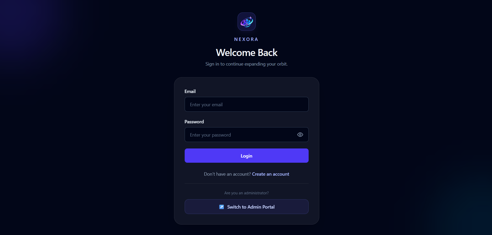 | 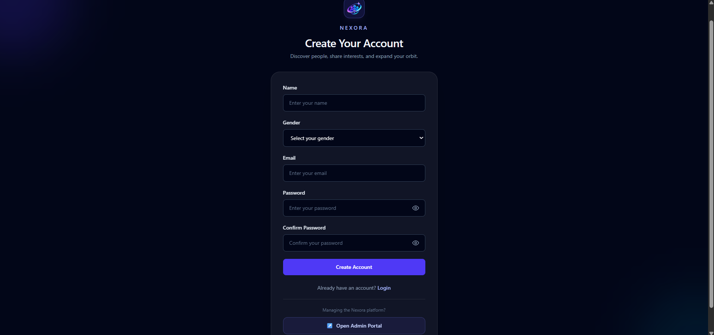 |

### Core Application

**Home Dashboard**

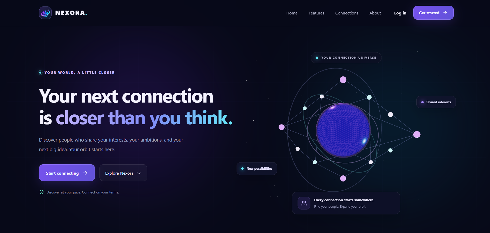

**Profile and Interests**

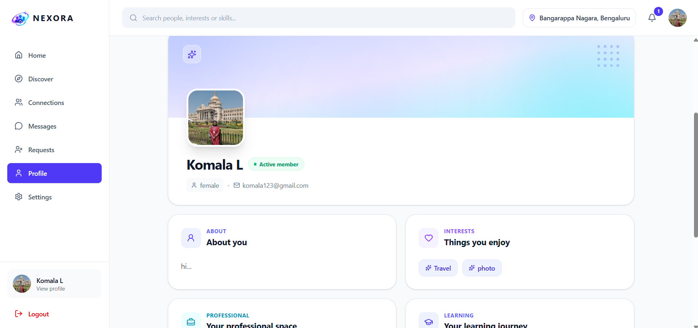

**Connections**

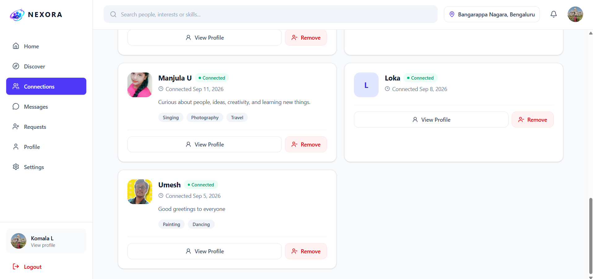

**Messaging**

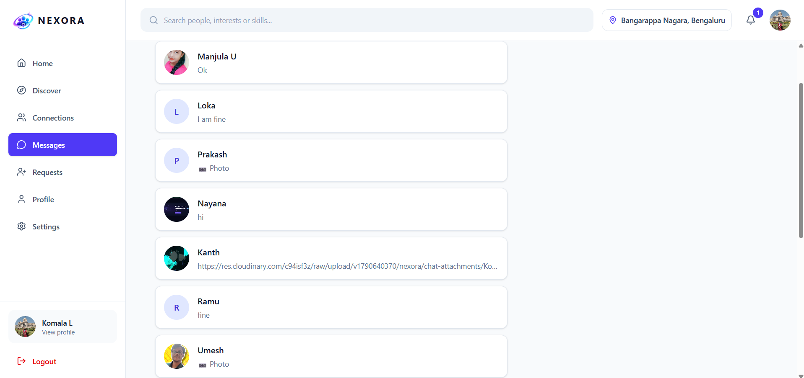

### Administration

**Admin Dashboard**

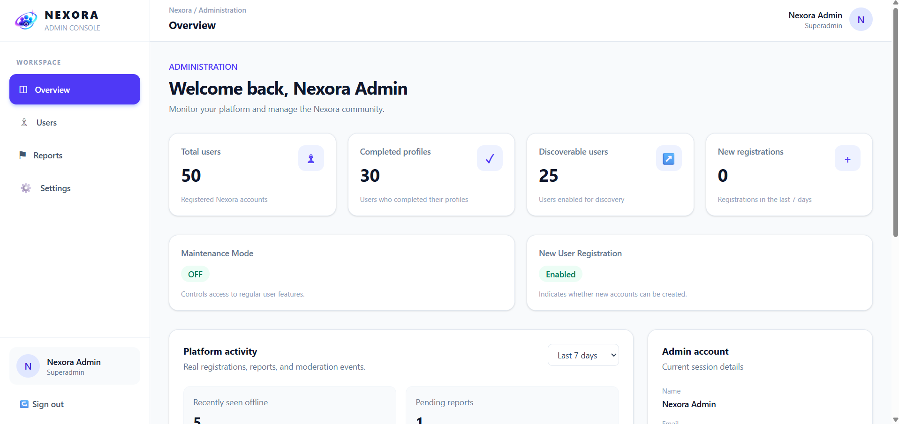

**User Management**

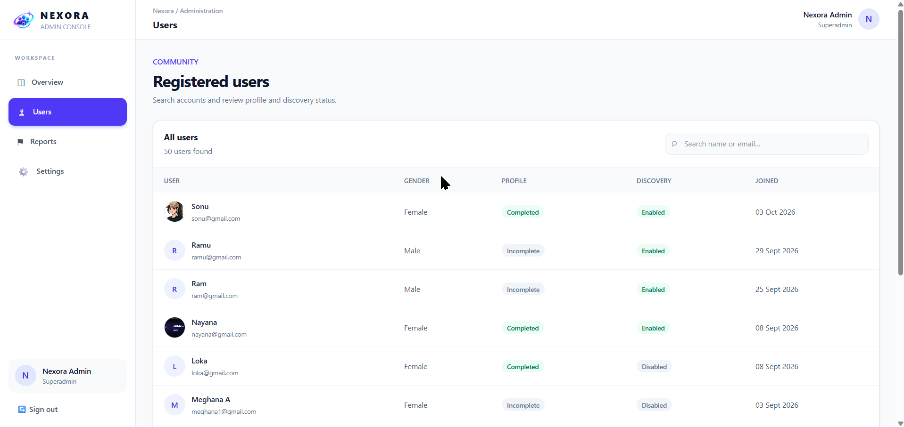

**Reports and Settings**

| Reports | Settings |
|---|---|
| 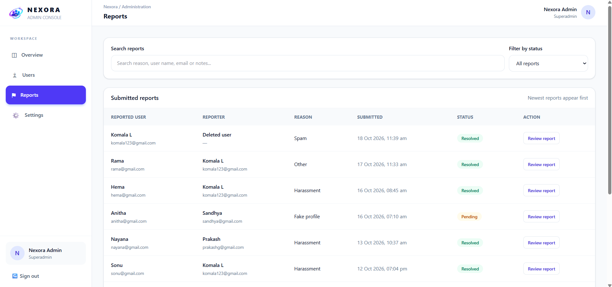 | 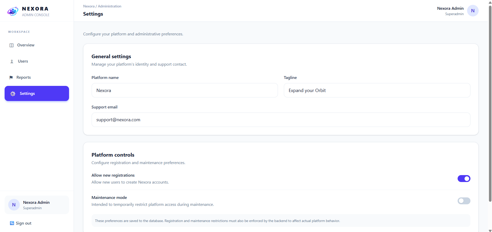 |

---

## 🧪 Development Progress

The main application modules cover:

- ✅ React frontend and Express backend structure
- ✅ User registration and login
- ✅ JWT-based authentication and cookie handling
- ✅ Runtime payload validation
- ✅ Profile management
- ✅ Location-aware discovery
- ✅ Connection-request workflows
- ✅ Conversation and message data model
- ✅ Administrative dashboard
- ✅ User management and report-review interface
- ✅ Application settings and registration controls
- ✅ Centralized backend error handling

---

## 👨‍💻 Author

**Komala L.**

Full-Stack Developer

- GitHub: [Komala-L](https://github.com/Komala-L)
- LinkedIn: [Komala-L](https://www.linkedin.com/in/komala-l-dev/)
- Portfolio: [Komala-L Portfolio](https://komala-l-portfolio.vercel.app/)
- Project: [Nexora](https://github.com/Komala-L/nexora)

---

## 📜 License

Copyright © 2026 Komala L. All rights reserved.